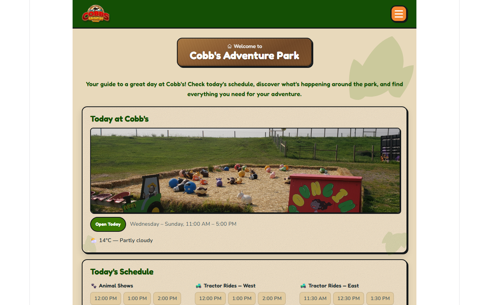
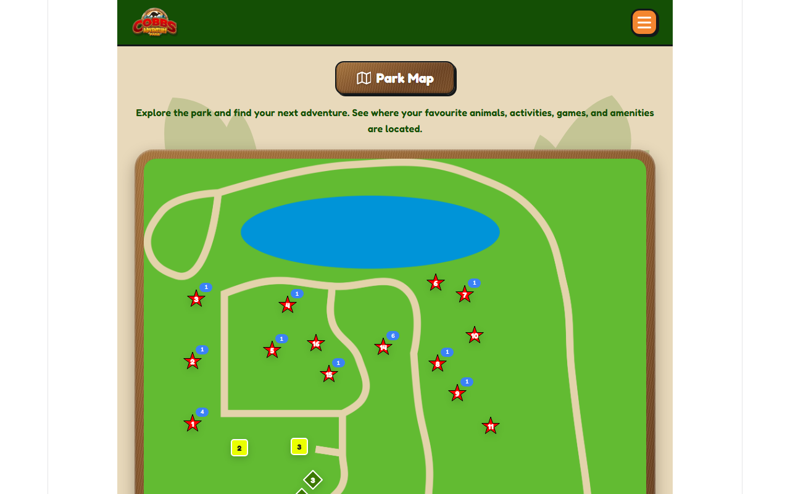
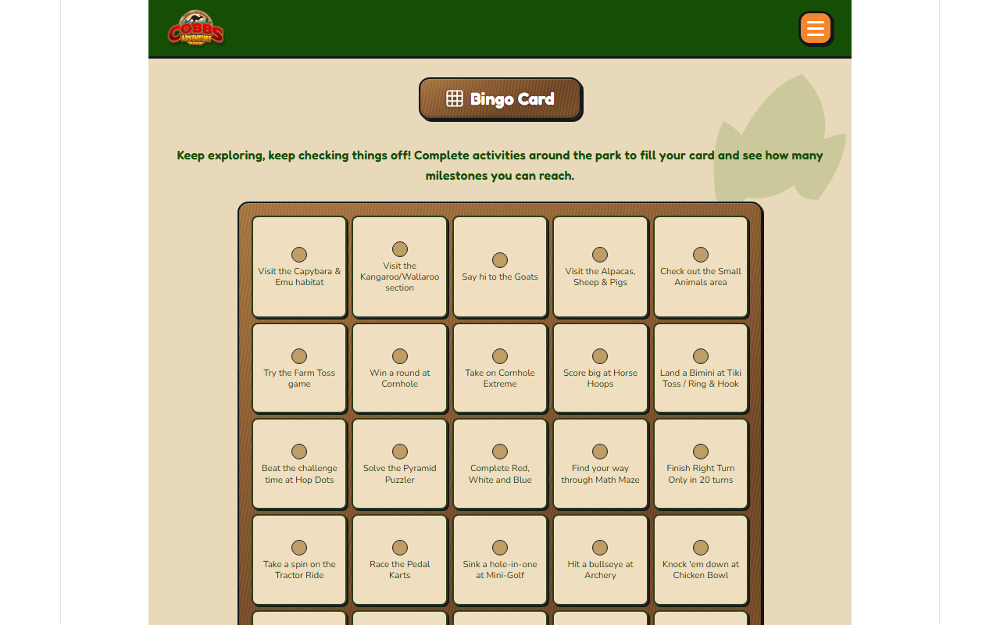
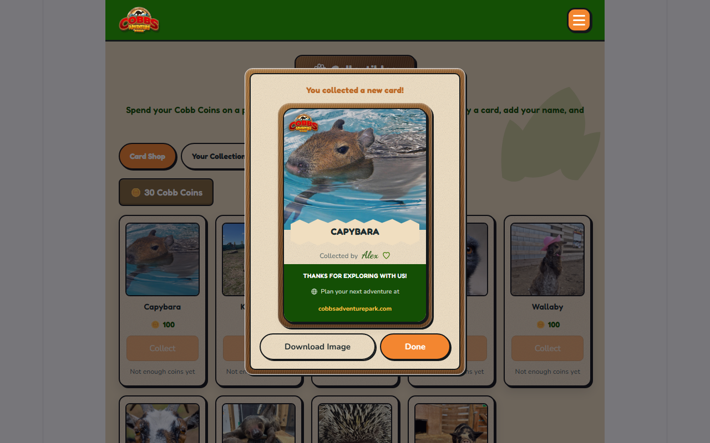
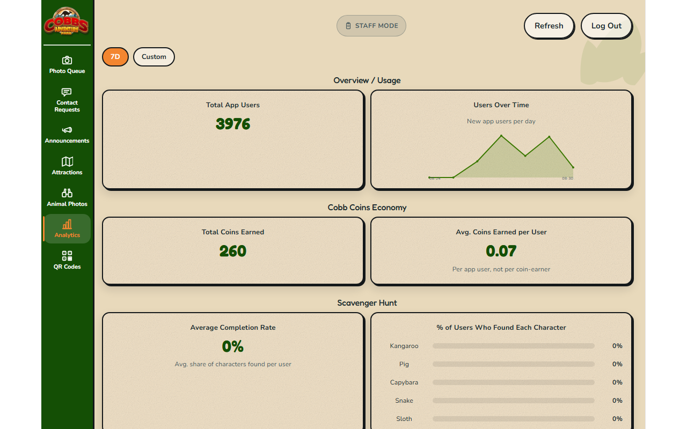

# Cobb's Companion App

A full-stack companion web app for **Cobb's Adventure Park**, a real family
petting-zoo/entertainment venue — an interactive map, scavenger hunt, bingo
card, minigames, and an in-app currency for guests, plus a full staff
administration and analytics system behind it. Built solo, end to end
(React/TypeScript frontend, FastAPI backend, Postgres database, 10 custom
Godot minigames, 48 Playwright end-to-end spec files), across many development
sessions.

**Live demo:** [cap-companion.melissajrichardson99.workers.dev](https://cap-companion.melissajrichardson99.workers.dev/)

> No sign-up needed. Guests are anonymous by default, identified by a
> per-device session token — walk up and start playing. An optional guest
> account (email + password) lets a family keep their coins, collectibles
> and progress across devices and visits. Staff features sit behind a single
> shared password, separate from both.

## Screenshots

| Home | Interactive Map |
|---|---|
|  |  |

| Bingo | Collectible card reveal |
|---|---|
|  |  |

**Staff Analytics dashboard**



## What it does

### Guest-facing

| Feature | What it is |
|---|---|
| **Home** | Weather, park announcements, a "how this app works" guide, quick links, Google reviews |
| **Interactive Map** | Staff-controlled open/closed attractions, per-family node-visit tracking |
| **Scavenger Hunt** | QR-driven character finding with multi-part challenges (quizzes, matching) |
| **Bingo** | Shared tile layout, independent per-family completion, milestone tiers (line / double-bingo / blackout) |
| **Cobb Coins** | In-app currency earned via Bingo milestones, Hunt completion, and full map exploration |
| **Collectibles** | Coins buy randomized, personalized, shareable animal photo cards |
| **Family Passport** | A generated keepsake summarizing a visit's stats |
| **Puzzle Timer / Scoring Sheet** | Timed and turn-based mini-activities for physical park games |
| **Favorite Photo** | Guest photo submission (staff-moderated), voting, "Photo of the Day" |
| **Our Animals** | Staff-managed photo galleries and fun facts per animal |
| **Food Trucks / FAQ** | Menus and park info |
| **QR scanning** | Camera scan + manual-code fallback, across four destination types: Hunt characters, Animals, Scoring games, Puzzle challenges |

### Staff-facing

Photo moderation queue, a Contact Staff inbox with status tracking
(open/acknowledged/resolved/cancelled) and guest-facing acknowledgment
notifications, Announcements (CRUD, with a guest popup for new/edited
posts), live attraction open/closed toggling, animal photo management
(add/delete/reorder — no developer needed), a QR Code directory generating
copyable signage URLs for every scannable destination in the app, and an
**Analytics dashboard** covering usage, the Cobb Coins economy, Hunt/Bingo/
Map engagement, Collectibles purchases, Puzzle/Scoring participation,
Photos/Passport stats, a "full completionist" rate, and Contact Staff
volume — all with a date-range filter.

## Tech stack

- **Frontend** — React 19 + TypeScript, Vite, React Router 7. Deployed to
  Cloudflare Workers (Static Assets).
- **Backend** — FastAPI (Python 3.13), deployed to Render.
- **Database / storage** — Supabase (Postgres + Storage).
- **Minigames** — 10 custom Godot 4.x projects exported to HTML5/WebGL,
  served from Cloudflare R2 through a small Worker (Godot's `.wasm` exports
  exceed Cloudflare's per-file static-asset cap).
- **Testing** — Playwright end-to-end (48 spec files, 363 tests), pytest
  for the backend (316 tests).
- **Auth model** — anonymous by default. Guests get a per-device session
  token (`X-Device-Session` header, generated client-side, stored in
  `localStorage`) that every stateful route reads/writes against. Optional
  guest accounts (email/password, bcrypt-hashed, `X-Guest-Auth` bearer
  token) link those device sessions so progress follows the guest across
  devices. Staff auth is a completely separate system: one shared password,
  signed session tokens via `itsdangerous`.

## Architecture

```
Browser (guest)          Browser (staff)
      |                        |
      | X-Device-Session       | Authorization: Bearer <staff token>
      v                        v
        React SPA (Cloudflare Workers Static Assets)
                     |
                     | HTTPS
                     v
            FastAPI backend (Render)
                     |
                     v
         Supabase (Postgres + Storage)

Minigames (Godot/WebGL) --> Cloudflare R2, streamed via a
small edge Worker mounted at /games/*
```

Every guest-stateful feature (Bingo progress, Hunt progress, coins,
collectibles, map visits, passport, favorite-photo votes) reads and writes
against rows keyed by that device session, so two families on two phones
never see or affect each other's progress. Staff routes ignore the guest
session system entirely and check a signed staff token instead.

## Engineering highlights

For more engineering deep-dives, see [ENGINEERING_NOTES.md](docs/ENGINEERING_NOTES.md).

### 1. The per-device session migration

The app originally had **one global shared session** for almost everything
— fine for a single staff member testing sequentially on one device, but a
hard blocker for real deployment: two families using the app at the same
time would see and overwrite each other's Bingo progress, coins, and votes.
Only Favorite Photo had ever had its own bespoke voter-isolation hack.

The migration went in as a staged rollout rather than one big-bang change.
Phase 0 shipped *only* the foundational plumbing — a session dependency
that mints an anonymous device-session row on first use — with no feature
reading it yet, verified with a real two-browser-context Playwright test
proving two contexts get distinct session IDs before a single feature was
touched. From there, each feature was migrated in turn, in deliberate
order: Coins/Collectibles, then Scoring/Puzzle Timer, then Map visit state,
then Family Passport, then Favorite Photo (retiring its old one-off voter
hack), then Bingo, and last — as the most interconnected — Scavenger Hunt.
Each phase got its own isolation-focused e2e spec asserting two concurrent
sessions can't see each other's state.

That last phase caught a real bug that only became *possible* once
per-session state existed: the "found every Hunt character" bonus check
was `all(character.completed for character in progress)` over what used to
be a globally pre-seeded, always-5-row table. Once progress rows were
created lazily per session, a family with exactly one completed character
and zero other rows would vacuously satisfy `all()` over that single-row
list — and get the "found them all" bonus after finding their first
character. The fix added an explicit count check (`len(progress) ==
total_characters and all(...)`) alongside the existing logic — a bug class
that's easy to miss by reading the old code in isolation, since it was
correct until the data model underneath it changed shape.

### 2. The routing overhaul and the back-button bug

For most of its life the app had no real client-side router — screens
switched via component state, with a hand-rolled `pushState`/`popstate`
shim bolted on for URL-bar cosmetics. That meant the browser's actual Back
button had nothing real to step through: after any amount of in-app
navigation, pressing Back exited the entire site — a bug real users hit
and reported, not a hypothetical.

The fix was diagnosed precisely (traced to exactly which navigation paths
did and didn't push real browser history) and resolved by adopting React
Router in one focused rewrite of the app's routing shell, backed by a
dedicated regression spec that walks Home → Map → Bingo → Scoring → FAQ and
asserts four consecutive `page.goBack()` calls land on each prior screen in
order, then that `page.goForward()` correctly replays the sequence forward.
The same rewrite made every scannable destination a real URL with real
params instead of a hand-rolled regex match, which is what made reliable
QR deep-linking to individual pages throughout the physical park possible
in the first place.

### 3. The Analytics dashboard's metric design

Rather than wiring up generic charts against whatever columns existed, the
dashboard's metrics follow a documented, deliberate convention: **event
metrics** (coins earned, node visits, collectible purchases, photos
submitted, staff requests) are windowed by their own row's timestamp,
while **per-session state metrics** (Bingo fill %, milestones, Hunt
characters found, and the booleans behind "Full Completionist") are
evaluated over a session's *entire* history rather than re-windowed a
second time — so a family that entered a date range in its last minute but
finished Bingo a minute later still counts, instead of nonsensically
fragmenting one continuous visit at a reporting boundary.

Ambiguous metrics get an explicit, reasoned choice instead of a silent
default: "average coins earned per user" divides by every app user in the
selected range, not just users who earned a coin, specifically to keep the
same denominator as the Overview panel's total-user count rather than
quietly redefining "per user" one panel over. And Puzzle Timer reports a
single honest `solves` count rather than fabricating an attempts-vs-
completions split the underlying data can't actually support — puzzle
attempts are only ever recorded *after* a successful solve, unlike Scoring
Sheet, which genuinely has a start/finish pair worth reporting separately.
It's a small set of decisions, but each one is a real judgment call about
what a number should mean before it becomes a chart — the kind of thinking
the data-analytics side of this project is meant to showcase.

### 4. QR infrastructure with a real, caught bug

Building the QR system meant real routes for every scannable destination
(Hunt characters, Animals, Scoring games, Puzzle challenges) and a
staff-facing directory that generates copyable URLs for physical park
signage. While adding a manual-code-entry fallback for guests without a
working camera, camera-based scanning itself turned out to be silently
broken for **3 of the 4** destination types: the code that extracted a
route from a decoded QR payload only ever matched the `/scan/…` (Hunt)
URL pattern, and anything else — an Animal, Scoring, or Puzzle QR code —
fell through to a fallback that returned the entire scanned URL as if it
were a bare code, silently routing to the wrong place with no visible
error.

The fix (`routeFromDecodedUrl`) parses the decoded payload as a real URL
and checks its path against all four registered route prefixes, landing in
the same commit as the manual-entry fallback and a matching backend
resolver that checks free-typed text against all four destination tables,
raising a real conflict error on a genuine cross-type slug collision. The
bug had been live and unnoticed until building the *fallback* for a
different problem accidentally exercised the *primary* path thoroughly
enough to expose it.

## Running it locally

Requires Node.js 24 (pinned in `frontend/.nvmrc`), Python 3.13, and a
Supabase project (free tier is fine).

```bash
# 1. Database
# In the Supabase SQL editor, run in order:
#   backend/supabase/schema.sql
#   backend/supabase/migrations/*.sql   (numeric order)
#   backend/supabase/seed.sql

# 2. Backend
cd backend
python -m venv venv && venv\Scripts\activate   # or `source venv/bin/activate` on macOS/Linux
pip install -r requirements.txt
cp .env.example .env   # see the variable list below
uvicorn app.main:app --reload
python -m pytest       # backend tests (no database needed)

# 3. Frontend (separate terminal)
cd frontend
npm install
npm run dev
```

`backend/.env` (every key is described in `backend/.env.example`):

| Variable | Needed for |
| --- | --- |
| `SUPABASE_URL`, `SUPABASE_KEY` | Required. Project URL and its `service_role` key. |
| `STAFF_PASSWORD`, `STAFF_SESSION_SECRET` | Required for the `/staff` area. |
| `CORS_ALLOWED_ORIGINS` | Optional locally (defaults to `http://localhost:5173`). |
| `FRONTEND_BASE_URL` | QR codes and password-reset email links. |
| `RESEND_API_KEY`, `RESEND_FROM_ADDRESS` | Password-reset emails (optional guest accounts). |
| `INTERNAL_CLEANUP_SECRET` | The scheduled session-cleanup endpoint. |
| `REFERENCE_CACHE_ENABLED` | Optional; unset means the reference cache is on. |
| `DEV_SUPABASE_PROJECT_REFS` | Dev machines only — see below. |

The frontend needs no `.env` locally: `VITE_API_BASE_URL` is optional and
defaults to `http://localhost:8000`.

The frontend runs at `http://localhost:5173` and talks to the backend at
`http://localhost:8000` by default. Minigames are exported separately from
`minigames/` and copied to `frontend/games-dist/` (not
`frontend/public/games/` — see `CLAUDE.md`), so a local checkout will run
the full app minus playable minigames unless that step is done too.

### Dev machine setup: `DEV_SUPABASE_PROJECT_REFS`

The e2e suite (`cd frontend && npx playwright test`) and the dev-only
scripts in `backend/scripts/` (`reset_demo_data.py`,
`cleanup_dev_test_data.py`, `e2e_run_cleanup.py`, `e2e_collision_fixture.py`,
`verify_session_cleanup.py`) wipe and reseed data with the service-role key.
They refuse to touch the database unless the project ref in `SUPABASE_URL`
(the `<ref>` in `https://<ref>.supabase.co`) is listed in
`DEV_SUPABASE_PROJECT_REFS`, so set it in your local `backend/.env`:

```bash
DEV_SUPABASE_PROJECT_REFS=<your-dev-project-ref>   # comma-separate several
```

Without it the e2e run stops at setup ("REFUSED") before any test runs.
**Never set this variable on Render or anywhere production runs.** Its
absence is what keeps these scripts from ever wiping the production
project. `migrate_animal_photos.py` is a real data migration rather than a
dev script, so it isn't behind this check: it prints its plan and asks for
`--yes` or a typed confirmation instead.

Full deployment ops notes (Cloudflare/Render/R2 setup, gotchas encountered
along the way) live in [`DEPLOYMENT.md`](DEPLOYMENT.md).

## Status

This is a solo-built portfolio project. Real deployment at the physical
park is on hold until next year; the live demo above runs the same code
against a standalone Supabase project. Active feature development is
currently paused while this repo is prepared for review.
